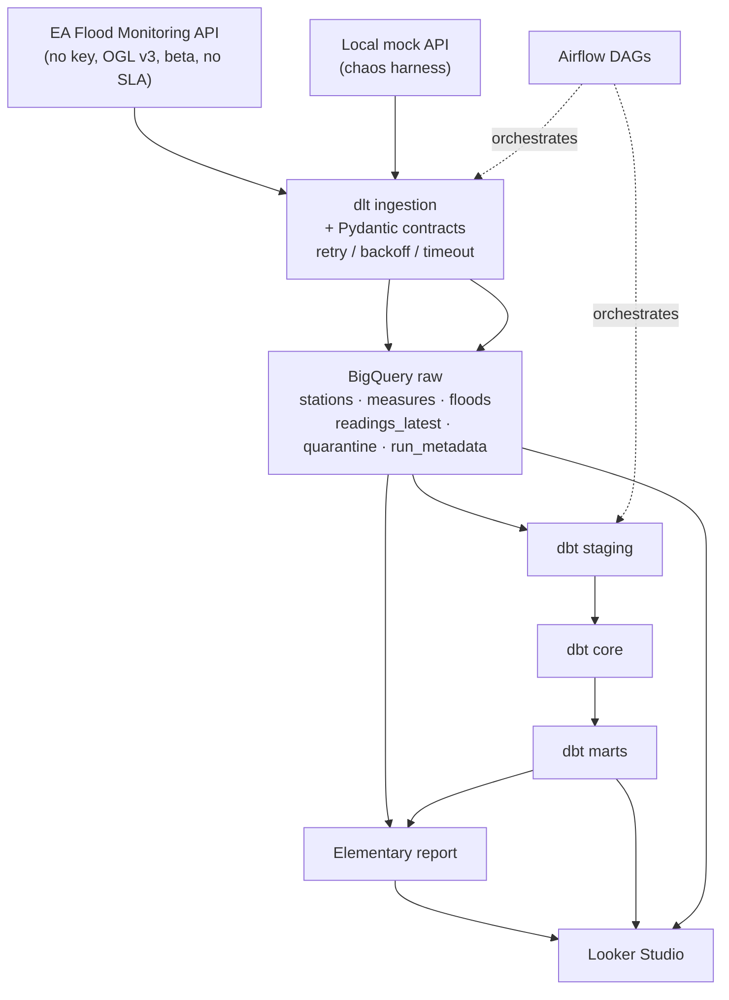

# UK Flood Pipeline — Product Requirements Document (PRD)

Status: **DRAFT — awaiting sign-off (Phase 0 GATE)**
Author: Data Engineering portfolio project
Last updated: 2026-10-12

## 1. Problem

Build a **resilient, observable batch ELT pipeline** over the UK Environment
Agency (EA) Flood Monitoring API. The API is a *beta* public service with no
API key (Open Government Licence v3), no SLA, occasional 5xx/4xx responses,
sparse fields, and inconsistent types. The project must demonstrate
automation, resilience, data quality, observability, performance optimisation
and structured debugging — each backed by evidence (tests, metrics, a recorded
chaos run), not claims.

The deliverable is a public portfolio repository plus a Looker Studio
dashboard. Success is judged as if by a hiring manager: can they clone it, run
it in <10 minutes, and see credible engineering evidence?

## 2. Success criteria (measurable)

| # | Criterion | How it is evidenced |
|---|-----------|---------------------|
| 1 | Reproducible: fresh clone → `make setup && make up` works with only `.env.example` defaults | CI "fresh-clone" job; README quickstart |
| 2 | Idempotent: re-running the same ingestion window yields **0 new duplicate** rows | pytest idempotency test asserting row counts across two runs |
| 3 | Data quality: dbt generic tests (unique/not_null/relationships/accepted_values) + **≥3 singular tests** + source freshness pass | `dbt build` green; test count reported |
| 4 | Quarantine: every contract failure is captured with `raw_payload`, `error_reason`, `load_id`; pipeline continues | pytest test injecting a bad row; quarantine table row |
| 5 | Observability: `run_metadata` table (rows loaded, quarantined, duration, schema-change events, `load_id`); Elementary report; dashboard | Elementary artifact committed / Pages; dashboard views |
| 6 | Resilience: retries with exponential backoff, timeouts, 429/5xx handling, documented API-down behaviour, catchup/backfill script | chaos scenarios 5–7; runbook |
| 7 | Chaos: **7 scenarios** reproduced against a local mock, each with documented breakage/response/dashboard effect | `docs/chaos-results.md` + run logs |
| 8 | Performance: before/after partitioning/clustering/incremental benchmark with **bytes scanned, runtime, estimated cost** | `docs/benchmarks.md`, real BigQuery job stats |
| 9 | CI: lint + pytest + `dbt parse` green; no secrets in history | GitHub Actions badge; `gitleaks`/manual grep |
| 10 | README claims each map to a test, metric or recorded run | README results tables |

## 3. Scope

- Ingest **stations**, **measures**, **active flood warnings** and
  **latest readings** from the EA API into BigQuery `raw`, with Pydantic
  contracts at the boundary and a quarantine table.
- Transform with **dbt** into `staging` → `core` → `marts`, with incremental
  models for readings, and deliberate partitioning/clustering.
- Orchestrate with **Airflow** (Docker Compose, LocalExecutor): ingestion every
  15 min, dbt build hourly, daily quality + housekeeping.
- Quality + observability via **dbt tests** and **Elementary**.
- Dashboard in **Looker Studio** over BigQuery views.
- Chaos + performance harness proving the resilience and optimisation claims.

## 4. Non-goals

- Real-time/streaming ingestion (batch only; also unsupported in BQ sandbox).
- Delta Lake, Spark, Kafka (excluded by fixed stack).
- Full historical archive ingest (the API only serves ~4 weeks of readings;
  archive CSVs are out of scope unless requested — see Open Q6).
- Production-grade secret management beyond `.env` / GitHub secrets.
- Multi-environment (dev/prod) deployment parity.

## 5. Constraints (fixed — no substitutions without asking)

Python 3.11+, SQL, **dlt** (ingestion), **Apache Airflow** (Docker Compose,
LocalExecutor), **BigQuery**, **dbt-bigquery**, **Elementary**, **Pydantic**
(contracts), **pytest**, **Docker**, **GitHub Actions**, **Looker Studio**.
No Delta Lake, no Spark. No API key; OGL attribution required. Idempotency
mandatory. Evidence required for every claim.

## 6. Environment status (Phase 0 verification, 2026-10-12)

| Tool | Status | Notes |
|------|--------|-------|
| Python | ✅ 3.13.9 default; 3.12 also installed (`py -3.12`) | No 3.11 via launcher. Airflow is not yet 3.13-safe → pin project to **3.12** (Airflow runs in Docker regardless). |
| uv | ✅ 0.11.15 | Use for dependency + interpreter management. |
| Docker | ✅ 29.8.2 (daemon up), Compose v5.5.1 | Needed for Airflow. |
| git | ✅ 2.50.0 | — |
| gh CLI | ⚠️ 2.102.0 installed, **not authenticated** | **Blocker for Phase 1** repo creation → `gh auth login` needed. |
| gcloud | ✅ 588.0.0, authed as `uswethaholla@gmail.com` | — |
| GCP project | ⚠️ `ukfloodpipeline` exists (ACTIVE, created 2026-10-11), **0 APIs enabled, billing DISABLED** | Billing account "My Billing Account" exists but `OPEN: False`. |

No installs performed. Ask before installing anything.

## 7. API findings (Phase 0 inspection of live payloads)

Common envelope for all endpoints: `{ "@context", "meta", "items" }`, where
`meta` carries `version` (0.9), `comment` ("Status: Beta service"), licence and
`hasFormat`. List endpoints always return `items` as an **array**.

| Endpoint | Observed count | Notes |
|----------|---------------|-------|
| `/id/floods` | 7 | Only *current* warnings; includes level-4 "no longer in force" for ~24h before removal. |
| `/id/stations` | 5538 | Sparse optional fields. |
| `/id/measures` | 7429 | 73% (5412) have an embedded `latestReading`. |
| `/data/readings?latest` | 5412 | Matches measures-with-latest exactly. |

### Confirmed quirks / risks

1. **Type inconsistency — reading `value` is not always numeric.** Observed
   `"value": [0.0, 0.0]` (a list) for one rainfall measure. All other 5411 were
   floats. → Pydantic contract must model `float | list | None`.
2. **`value` can be absent.** Per docs, `NaN` is illegal JSON and any NaN
   reading omits `value` entirely. → `value` must be Optional.
3. **Type inconsistency — station coordinates.** `lat` had 1 list value and 637
   nulls; `easting` had 4 floats + 1 list + 637 nulls. → coerce/normalise in
   staging; validate in contract.
4. **Sparse fields on stations** (of 5538): `RLOIid` 2575, `catchmentName`
   2575, `dateOpened` 2575, `lat/long/easting/northing` 4901, `status` 2575,
   `riverName` 2575, `town` 2421, `measures` 5523 (15 stations have none).
5. **Nested structures:** `floodArea` object inside floods; `measures[]` array
   inside stations; `latestReading` object inside measures. dlt handles nesting
   via normalisation, but we must decide flattening keys deliberately.
6. **Timezone inconsistency:** floods timestamps (`timeRaised` etc.) have **no
   timezone** (`2026-10-11T16:34:06`); readings `dateTime` end in **`Z`**.
   → normalise to UTC in staging; flag as a quality test.
7. **Sparse measures:** `latestReading` 5412/7429, `datumType` 3436/7429,
   `unit` 7054/7429, `period` 7413/7429.
8. **Dirty categoricals:** `unitName` values include `'---'` (348), `''`,
   `'None'`; `qualifier` includes `''`, `'1'`, `'2'`, `'None'`. → accepted-values
   tests must whitelist *and* quarantine/reject explicitly.
9. **Odd parameters exist:** `people_count`, `area`, `freeze_level`, `state`,
   `velocity` beyond the documented level/flow/rainfall/temperature/wind.
10. **Query-parameter gotchas:**
    - `?since=` is **only** valid on per-measure / per-station readings, not
      global `/data/readings` → returned **HTTP 400**.
    - `?station=` requires a **URI**; passing a reference (`station=1029TH`)
      returned **HTTP 500**. Use `?stationReference=1029TH`.
    - Size limits: readings default 500, hard cap 10000; `latest`/`date`/`today`
      /`measure` remove the default. `meta.limit`/`meta.offset` reported.
11. **History window:** readings API covers only ~last 4 weeks; older data only
    via daily archive CSVs at `/archive/readings-{full-}{date}.csv`.
12. **No duplicates** by `@id` observed in any snapshot; `@id` is the natural
    key. Re-running `?latest` produces a rolling snapshot (each measure's newest
    value) → idempotency key must be `(@id)` or `(measure, dateTime)`.
13. **Beta / no SLA / caching / redirects:** docs warn responses may be cached,
    may redirect under load, and the service is not guaranteed. Client must
    follow redirects and tolerate 429/5xx.

## 8. Architecture

## 9. Data model (raw / staging / core / marts)

- **raw** (dlt-owned): `stations`, `measures`, `flood_warnings`, `readings_latest`,
  plus `quarantine` (raw_payload JSON, error_reason, load_id, failed_at) and
  `run_metadata` (load_id, resource, rows_loaded, rows_quarantined, started_at,
  ended_at, duration_s, status, schema_change_flag).
- **staging** (dbt views): typing, renaming, timestamp normalisation to UTC,
  dedupe on natural keys; `stg_stations`, `stg_measures`, `stg_readings`,
  `stg_flood_warnings`. Flatten chosen nested fields with documented keys.
- **core** (dbt): `dim_station`, `dim_measure`, `dim_flood_area`,
  `fct_readings` (incremental, partitioned by DATE(dateTime), clustered by
  measure_id), `fct_flood_warnings`.
- **marts** (dbt): `mart_station_reliability` (reading completeness/freshness per
  station), `mart_river_level_trends`, `mart_rainfall_trends`,
  `mart_flood_warning_history`.

## 10. Plan by phase (gated)

0. **Discovery & PRD** — this document. [GATE]
1. **Repo & scaffolding** — repo name/visibility/licence/structure [GATE], then
   `git init`, `gh repo create`, topics, branch-per-phase + PRs, `pyproject.toml`
   (uv), pre-commit (ruff, sqlfluff), Makefile, docker-compose Airflow, CI.
2. **Ingestion** — dlt pipelines, deliberate write dispositions, Pydantic
   contracts, quarantine, retries/timeouts/rate-limit handling, fixture-based
   unit tests.
3. **Transformation** — dbt layers, incremental readings, partition/cluster,
   generic + ≥3 singular tests, freshness, Elementary anomaly tests.
4. **Orchestration** — Airflow DAGs (15-min ingest, hourly dbt, daily quality/
   housekeeping), dynamic task mapping, retries/SLA/failure callbacks,
   catchup/backfill, documented API-down behaviour, alerting (off by default).
5. **Observability & dashboard** — run-metadata table, Elementary artifact,
   Looker Studio views + setup steps.
6. **Chaos & performance** — `scripts/chaos.py` over a mock API (7 scenarios),
   documented outcomes; before/after benchmark with real BigQuery stats.
7. **Docs & polish** — README, runbook, data dictionary, fresh-clone check,
   CI green, no secrets.

## 11. Risks

| Risk | Impact | Mitigation |
|------|--------|-----------|
| BigQuery **sandbox blocks DML** → breaks dlt `merge`, dbt incremental, Elementary inserts | High | Recommend billing-enabled project (option a) with budget alert; else redesign around load-job replace + re-seed (significant rework) |
| 60-day table expiry (sandbox only) | High | Billing-enabled project, or automated re-seed script |
| GCP costs if billing enabled | Medium | Budget alert + cap £1–£5; BigQuery free tier (1 TiB query, 10 GB storage); set `maximum_bytes_billed` per query; partition/cluster |
| API is beta / no SLA / 429 / 5xx | Medium | Retries w/ backoff, timeouts, circuit-break quarantine, documented down-behaviour |
| Reading `value`/coordinate type anomalies | Medium | Pydantic coercion + quarantine; staging normalisation |
| Readiness: `gh` not authenticated | Blocker for Phase 1 | `gh auth login` before Phase 1 |
| Python 3.13 vs Airflow compatibility | Low | Pin project to 3.12 via uv; Airflow in Docker |
| Local Airflow on Windows | Medium | Run Airflow via Docker Compose (Linux containers) as specified |

## 12. Open questions (need your answers before Phase 1)

1. **BigQuery decision — pick (a) or (b):**
   - **(a) Billing-enabled `ukfloodpipeline` + budget alert (recommended).**
     Pros: DML, streaming, permanent tables; full dbt incremental/merge and
     Elementary work; no re-seed. Cons: requires a payment method on the billing
     account (currently closed); small cost risk, mitigated by budget alert +
     BigQuery free tier + `maximum_bytes_billed`. Expected cost for this
     workload ≈ £0.
   - **(b) Sandbox + re-seed script.** Pros: no card. Cons: **no DML** →
     dlt `merge` dispositions, dbt `incremental` (MERGE) and Elementary break by
     default (they'd need load-job/`replace` workarounds); 60-day expiry forces
     periodic re-seed; 10 GB lifetime cap. Materially more work and weaker
     demonstration of incremental performance optimisation.

   Note: `ukfloodpipeline` already exists but has **billing disabled** and **0
   APIs enabled**. Choosing (a) means reopening/attaching a billing account and
   enabling the BigQuery API (a billable/irreversible-ish action → I'll show a
   plan and wait before doing it).

2. **Retention:** do you need data to persist beyond 60 days? (Determines
   whether (b) is even viable.)
3. **Cost appetite:** acceptable monthly budget-alert threshold (e.g. £1, £5)?
   Any objection to adding a payment method?
4. **Repo:** name (`uk-flood-pipeline`?), visibility (public default), owner
   (your personal account?). Confirm before I create it.
5. **Alerting channel:** Slack webhook or email? (Configured but **off by
   default** either way.)
6. **History scope:** stick to `?latest` snapshots, or also pull the ~4-week
   window via `?date`/`?startdate`/`?enddate` for richer trends? (More data =
   better marts, still tiny.)
7. **`gh auth login`**: can you authenticate `gh` before Phase 1, or should I
   fall back to creating the remote manually and pushing?

## 13. What I will NOT do without explicit "proceed"

- Enable billing / enable GCP APIs / create any billable or irreversible cloud
  resource.
- Create the GitHub repo (Phase 1 gate).
- Commit or push anything.
